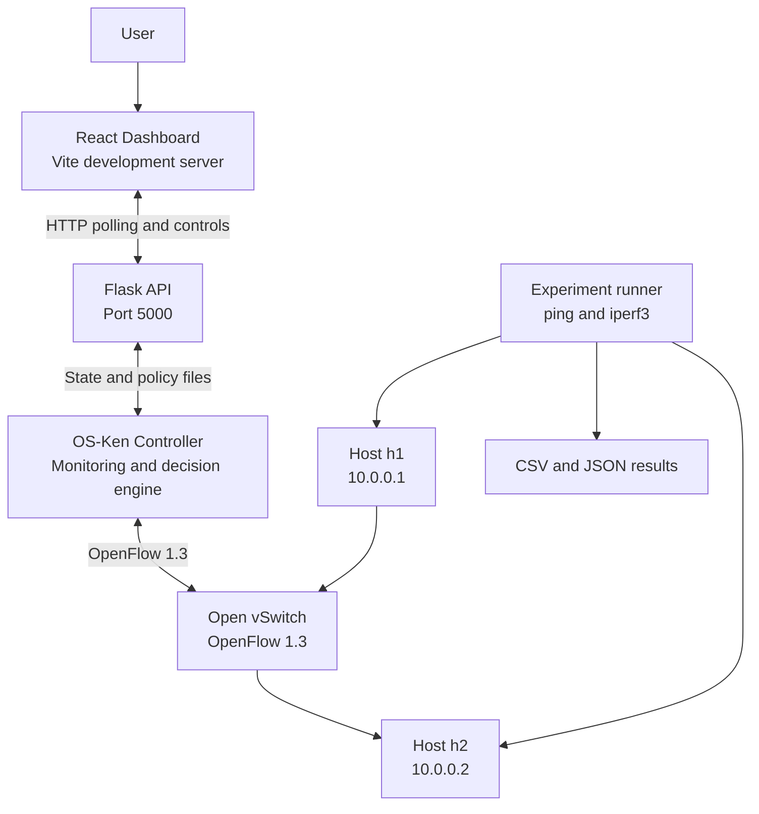
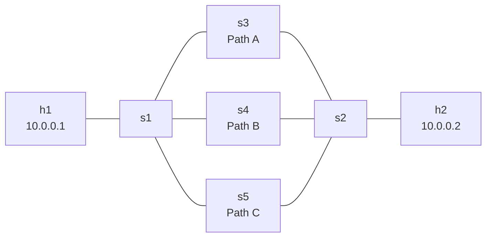

# Adaptive Traffic Switching Across Multiple Networks using SDN


> A Software-Defined Networking (SDN) simulation that monitors multiple virtual network paths and dynamically redirects traffic to a better available path when network conditions degrade.

This project demonstrates adaptive traffic switching in a controlled Mininet environment. An OS-Ken SDN controller monitors three alternative paths, evaluates their measured network conditions, and updates OpenFlow forwarding rules to switch traffic. A Flask API and React dashboard expose the current path, network metrics, switching events, and experiment reports.

The project compares **static routing** with **adaptive switching** using repeatable experiments that introduce delay, packet loss, and link failure.

## Table of Contents

- [Overview](#overview)
- [Objectives](#objectives)
- [Key Features](#key-features)
- [Technology Stack](#technology-stack)
- [System Architecture](#system-architecture)
- [Network Topology](#network-topology)
- [How It Works](#how-it-works)
- [Adaptive Decision Algorithm](#adaptive-decision-algorithm)
- [Repository Structure](#repository-structure)
- [Requirements](#requirements)
- [Installation and Setup](#installation-and-setup)
- [Running the Project](#running-the-project)
- [Using the Dashboard](#using-the-dashboard)
- [Running the Experiment](#running-the-experiment)
- [Experimental Results](#experimental-results)
- [Output Files](#output-files)
- [Troubleshooting](#troubleshooting)
- [Limitations](#limitations)
- [Future Improvements](#future-improvements)

## Overview

Traditional static forwarding continues to use a selected path even when its performance becomes poor, unless routing or forwarding configuration changes. This project explores how an SDN controller can observe candidate paths centrally and update forwarding rules when another path offers a sufficiently better option.

The simulation contains three virtual paths:

- **Path A — Home Wi-Fi**
- **Path B — Mobile data**
- **Path C — College network**

These are logical labels used by the simulation, not connections to actual Wi-Fi, cellular, or campus networks. Mininet and Linux traffic-control tools emulate their network conditions.

## Objectives

- Build a multi-path network topology using Mininet and Open vSwitch.
- Use an OS-Ken controller with OpenFlow 1.3 to manage forwarding.
- Monitor latency, packet loss, throughput estimates, and link availability.
- Compare static forwarding against adaptive path selection.
- Inject controlled network degradation and link failures.
- Display network state and switching decisions through a web dashboard.
- Generate experiment summaries for analysis and project reporting.

## Key Features

### SDN control and path switching
- Three candidate paths between source host `h1` and destination host `h2`.
- OpenFlow forwarding rules installed on the switches.
- Automatic switching when the active path is unavailable or another path is consistently better.
- Manual path selection through a local command file and dashboard controls.

### Network monitoring
- Probe-based latency and packet-loss estimation.
- OpenFlow port statistics used to estimate transmitted throughput.
- Port-status events used to track link availability.
- Recent controller events and path scores exposed to the dashboard.

### Dashboard and reporting
- React dashboard built with Vite and Recharts.
- Flask API for current state, controls, impairment settings, and reports.
- Static and adaptive operating modes.
- Experiment result files in CSV and JSON formats.
- Average metrics calculated across repeated runs.

## Technology Stack

| Layer | Technology | Purpose |
|---|---|---|
| Network emulator | Mininet | Creates hosts, switches, and virtual links |
| Virtual switches | Open vSwitch | Forwards traffic through the selected path |
| SDN protocol | OpenFlow 1.3 | Communicates forwarding rules between controller and switches |
| SDN controller | OS-Ken | Measures candidate paths and makes switching decisions |
| Network impairment | Linux `tc` / `netem` and `ip` | Emulates delay, packet loss, and link outages |
| Traffic testing | `ping`, `iperf3` | Measures connectivity and UDP traffic performance |
| Backend API | Flask | Serves state, controls, and experiment reports |
| Frontend | React, Vite, Recharts | Displays path metrics and experiment information |
| Language | Python | Controller integration, experiment automation, API, and analysis |
| Version control | Git and GitHub | Source-code and experiment history |

## System Architecture



The controller communicates with the Open vSwitch instances over OpenFlow 1.3. It probes the alternative paths, computes path scores, and modifies forwarding rules at the ingress and egress switches to direct traffic through the selected path. The Flask API reads controller state and provides dashboard endpoints and control operations.

## Network Topology

The Mininet topology contains two end hosts and five switches. Three intermediate switches provide separate paths between the ingress switch `s1` and egress switch `s2`.



| Path | Intermediate switch | Ingress switch port on `s1` | Simulated label |
|---|---|---:|---|
| A | `s3` | 2 | Home Wi-Fi |
| B | `s4` | 3 | Mobile data |
| C | `s5` | 4 | College network |

The controller uses OpenFlow port mappings to select the active path. Link impairments are applied on the `s1`-side path interfaces.

## How It Works

1. **Topology creation:** Mininet creates `h1`, `h2`, the ingress/egress switches, and the three intermediate path switches.
2. **Controller connection:** Open vSwitch connects to OS-Ken using OpenFlow 1.3.
3. **Path probes:** The controller periodically sends probe packets through each candidate path and records probe round-trip times and missing replies.
4. **Throughput monitoring:** The controller polls OpenFlow port statistics and calculates an estimated transmit rate from changes in transmitted bytes.
5. **Availability monitoring:** OpenFlow port-status events indicate when a path link goes up or down.
6. **Path scoring:** The decision engine combines measured latency, packet loss, and any configured path penalty into a score.
7. **Decision stability:** A challenger must satisfy the improvement rules over consecutive checks. A cooldown reduces repeated switching.
8. **Forwarding update:** When switching is warranted, the controller updates forwarding rules to direct traffic over the selected path.
9. **Visualization and evaluation:** Flask exposes current state and events; the dashboard presents them, while the experiment runner compares static and adaptive modes.

## Adaptive Decision Algorithm

The current controller calculates a score for each available path:

\[
\text{Score}(p) = \text{Latency}_{p} + 10 \times \text{Loss}_{p} + \text{Penalty}_{p}
\]

Where:

- \(\text{Latency}_{p}\) is the measured probe latency in milliseconds.
- \(\text{Loss}_{p}\) is the measured packet-loss percentage.
- The factor `10` weights each percentage point of packet loss in the score.
- \(\text{Penalty}_{p}\) is an optional policy cost, for example to discourage use of a simulated metered mobile-data path.
- A path that is down or has no usable latency measurement is assigned an infinite score.

The score is a project-defined heuristic, not a standardized networking metric. Its weights and penalty values are configurable in the project code.

### Switching conditions

In adaptive mode, the controller uses the following safeguards:

| Setting | Current value | Meaning |
|---|---:|---|
| Probe interval | 0.5 seconds | Time between probe cycles |
| Probe timeout | 1.5 seconds | Time before a missing probe is treated as lost |
| History length | 20 samples | Maximum recent probe outcomes retained per path |
| Warm-up samples | 8 | Samples required per path before normal decisions |
| Challenger ratio | 0.8 | Challenger score must be below 80% of the active path score |
| Minimum score gain | 20 points | Challenger must also beat the active score by more than 20 points |
| Consecutive checks | 3 | Improvement must persist across three decision checks |
| Cooldown | 10 seconds | Minimum delay between normal path switches |

If the active path is unavailable and a usable alternative exists, the controller can switch immediately rather than waiting for the normal improvement streak.

## Repository Structure

```text
SDN-based-ANS/
├── app.py                       # Flask API, dashboard controls, sampling and reports
├── average.py                   # Calculates averages from results_run*/summary.json
├── controller.py                # Current OS-Ken controller and adaptive decision logic
├── controller_v1.py             # Earlier controller version
├── controller_v2.py             # Earlier controller version
├── run_experiment.py            # Static/adaptive experiment automation
├── topo.py                      # Mininet topology definition
├── results_average.json         # Aggregated metrics across experiment runs
├── results_run1/
│   ├── summary.csv
│   ├── summary.json
│   ├── timeline_adaptive.csv
│   └── timeline_static.csv
├── results_run2/                # Second run outputs
├── results_run3/                # Third run outputs
├── backup_v1/                   # Earlier implementation backups
├── backup_v2/                   # Earlier implementation backups
├── dashboard/
│   ├── index.html
│   ├── package.json
│   ├── package-lock.json
│   ├── vite.config.js
│   └── src/
│       ├── App.jsx               # Dashboard UI
│       ├── main.jsx              # React entry point
│       └── styles.css            # Dashboard styling
├── .gitignore
└── README.md
```

## Requirements

This project is designed for a Linux environment with Mininet and Open vSwitch support. Ubuntu is recommended for the supplied commands.

Install or verify the following:

- Python 3
- Mininet
- Open vSwitch
- OS-Ken installed in a Python virtual environment
- Flask and Flask-CORS in the environment used by `app.py`
- Node.js and npm
- `iperf3`
- `iproute2` tools, including `ip` and `tc`

Check common tools:

```bash
python3 --version
mn --version
ovs-vsctl --version
node --version
npm --version
iperf3 --version
tc -V
```

OS-Ken and Flask dependencies must be installed in the Python environment used to launch the controller and API. If you use a virtual environment named `venv`, activate it before starting these Python services.

> Mininet, Open vSwitch, network namespaces, and traffic-control operations generally require Linux privileges. This project is a simulation and does not automatically connect to real Wi-Fi, cellular, or campus networks.

## Installation and Setup

### 1. Clone the repository

```bash
git clone https://github.com/anikethpa-stack/SDN-based-ANS.git
cd SDN-based-ANS
```

If you already have the repository locally, enter your project directory instead.

### 2. Create and activate a Python virtual environment

```bash
python3 -m venv venv
source venv/bin/activate
```

If the environment does not include pip, install the relevant Ubuntu package for virtual environments, then recreate the environment.

### 3. Install Python dependencies

Install the packages used by the controller and Flask API in the virtual environment. At minimum, the current code imports OS-Ken, Flask, and Flask-CORS.

```bash
python -m pip install os-ken Flask Flask-Cors
```

If you maintain a requirements file in a future version, prefer installing from that file instead.

### 4. Install dashboard dependencies

```bash
cd dashboard
npm install
cd ..
```

## Running the Project

Run the components in separate terminal windows, from the project root unless otherwise stated. Start the controller and dashboard before testing the network.

### Terminal 1 — Start the OS-Ken controller

Activate the virtual environment if needed, then run:

```bash
source venv/bin/activate
osken-manager controller.py
```

The controller listens for OpenFlow connections on port `6653` by default. Keep this terminal open.

If `osken-manager` is not found, confirm OS-Ken is installed in the active environment and try:

```bash
python -m pip show os-ken
```

### Terminal 2 — Start the Mininet topology

From the project root:

```bash
sudo python3 topo.py
```

Mininet starts the hosts and switches and opens its CLI. Keep this terminal open while testing.

Useful Mininet commands include:

```text
pingall
h1 ping -c 5 h2
net
nodes
```

Exit the Mininet CLI with `exit` when you want to stop the topology.

### Terminal 3 — Start the Flask API

From the project root:

```bash
source venv/bin/activate
sudo venv/bin/python app.py
```

The Flask API is configured to listen locally on port `5000`. It uses privileged network commands for controls that change link state or traffic shaping, so run it only in your trusted local simulation environment.

### Terminal 4 — Start the React dashboard

```bash
cd dashboard
npm run dev
```

Open the local Vite URL printed in the terminal, typically:

```text
http://localhost:5173
```

Keep all four components running while using the dashboard.

## Using the Dashboard

The dashboard communicates with the Flask API and displays controller state and path metrics. Depending on the current implementation, available controls include:

- Viewing the currently selected path.
- Comparing latency, loss, and throughput estimates across paths.
- Inspecting controller events and switching decisions.
- Changing static/adaptive mode.
- Selecting a path manually.
- Applying simulated delay, loss, or link-down conditions.
- Viewing or downloading generated reports.

The controller and API exchange runtime state through files under `/tmp`, including `/tmp/sdn_state.json`, `/tmp/mode.txt`, `/tmp/active_path.txt`, and `/tmp/net_policy.json`. These are runtime files and are not repository artifacts.

A manual path selection can also be requested from a terminal:

```bash
echo B > /tmp/active_path.txt
```

Replace `B` with `A` or `C` to select another path. This assumes the controller is running and the local runtime file has been initialized.

To request static mode:

```bash
echo static > /tmp/mode.txt
```

Adaptive mode:

```bash
echo adaptive > /tmp/mode.txt
```

## Running the Experiment

The supplied experiment script compares static and adaptive operation using the same scenario.

> Run this experiment only after checking that the controller and required tools are installed. The script creates a Mininet topology, applies traffic impairments, and changes virtual link state. It requires sufficient privileges.

From the project root:

```bash
sudo python3 run_experiment.py
```

The current experiment configuration is:

| Parameter | Value |
|---|---:|
| Duration per mode | 60 seconds |
| UDP traffic rate | 4 Mbps |
| Ping interval | 0.2 seconds |
| Path A degradation starts | 10 seconds |
| Path A degradation | 150 ms delay and 30% packet loss |
| Path B link failure starts | 30 seconds |
| Network restoration begins | 50 seconds |
| Modes compared | Static and adaptive |

The experiment uses `ping` and `iperf3` to measure connectivity and UDP performance. It writes per-run summary and timeline files to the `results/` directory. The committed `results_run1/`, `results_run2/`, and `results_run3/` directories contain recorded runs, and `average.py` aggregates their summary metrics.

To calculate the averages from the saved runs:

```bash
python3 average.py
```

This writes `results_average.json` based on the available `results_run*/summary.json` files.

## Experimental Results

The following values are from the repository's saved `results_average.json` file and represent the average of three recorded runs.

| Metric | Static | Adaptive |
|---|---:|---:|
| Ping packet loss | 20.33% | 1.90% |
| UDP packet loss | 19.97% | 1.77% |
| Average RTT | 93.13 ms | 14.83 ms |
| 95th-percentile RTT | 155.00 ms | 10.23 ms |
| Goodput (from 4 Mbps offered UDP rate) | 3.20 Mbps | 3.93 Mbps |
| Path switches | 0 | 2 |
| First switch after degradation | N/A | 2.8 s |

These are simulation results from the included experiment data, not guarantees of performance on a physical network. Re-run the experiments to verify results after changing the topology, controller, traffic pattern, or scoring parameters.

## Output Files

| Output | Description |
|---|---|
| `results_run*/summary.csv` | Tabular metrics for an individual run |
| `results_run*/summary.json` | Structured metrics used by the averaging script |
| `results_run*/timeline_static.csv` | Per-second static-mode ping loss and RTT timeline |
| `results_run*/timeline_adaptive.csv` | Per-second adaptive-mode ping loss and RTT timeline |
| `results_average.json` | Aggregated static and adaptive metrics |
| `reports/` | HTML reports generated by the Flask API, when enabled |

Keep experiment results that are used in the report or dashboard under version control. Avoid committing temporary logs, virtual environments, dependency folders, or credentials.

## Troubleshooting

### `osken-manager: command not found`

Activate the virtual environment and verify OS-Ken is installed there:

```bash
source venv/bin/activate
python -m pip show os-ken
which python
```

### Mininet switches fall back to OVS bridge mode

Start the OS-Ken controller before starting the topology. Confirm that the controller is listening on port `6653` and that the switches connect using OpenFlow 1.3.

### Flask controls report that an interface is missing

Confirm that the Mininet topology is running. Interfaces such as `s1-eth2`, `s1-eth3`, and `s1-eth4` exist only while the topology is active.

### Dashboard cannot reach the API

Check that Flask is running on port `5000` and Vite is running on port `5173`. Check browser console messages and API requests for connection or CORS errors.

### `iperf3` is unavailable

Install `iperf3` using your Linux distribution's package manager and verify it with:

```bash
iperf3 --version
```

### Permission errors with `tc` or `ip link`

The experiment and Flask controls that alter network interfaces require appropriate privileges. Use the documented local simulation setup and avoid exposing the privileged API to untrusted networks.

## Limitations

- This is a Mininet/OVS simulation, not a demonstration over physical Wi-Fi, cellular, or campus infrastructure.
- Network labels and baseline characteristics represent simulated scenarios.
- The path score is a heuristic that combines latency, packet loss, and optional policy penalties; it is not a universal QoS formula.
- Measurements depend on probe timing, traffic load, virtual-machine resources, and experiment configuration.
- The included result table reflects the currently committed experimental runs and may differ when experiments are repeated.

## Future Improvements

- Add configurable weights and explainable score breakdowns for different application intents.
- Expand experiments across more traffic types and longer durations.
- Add repeatable experiment configuration and automatic result validation.
- Export publication-ready plots for latency, loss, throughput, and switching events.
- Add tests for the score calculation and switching thresholds.
- Document dashboard screenshots and additional experiment scenarios.

---

**Project:** Adaptive Traffic Switching Across Multiple Networks using SDN  
**Repository:** [anikethpa-stack/SDN-based-ANS](https://github.com/anikethpa-stack/SDN-based-ANS)
